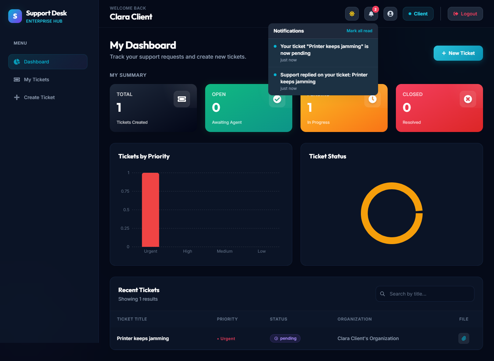
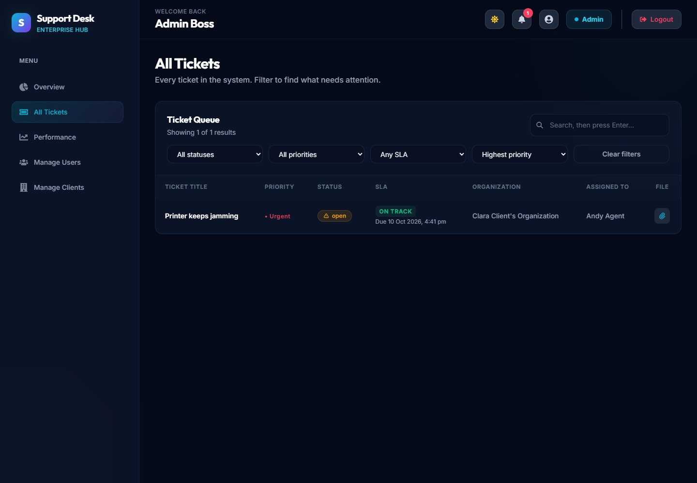
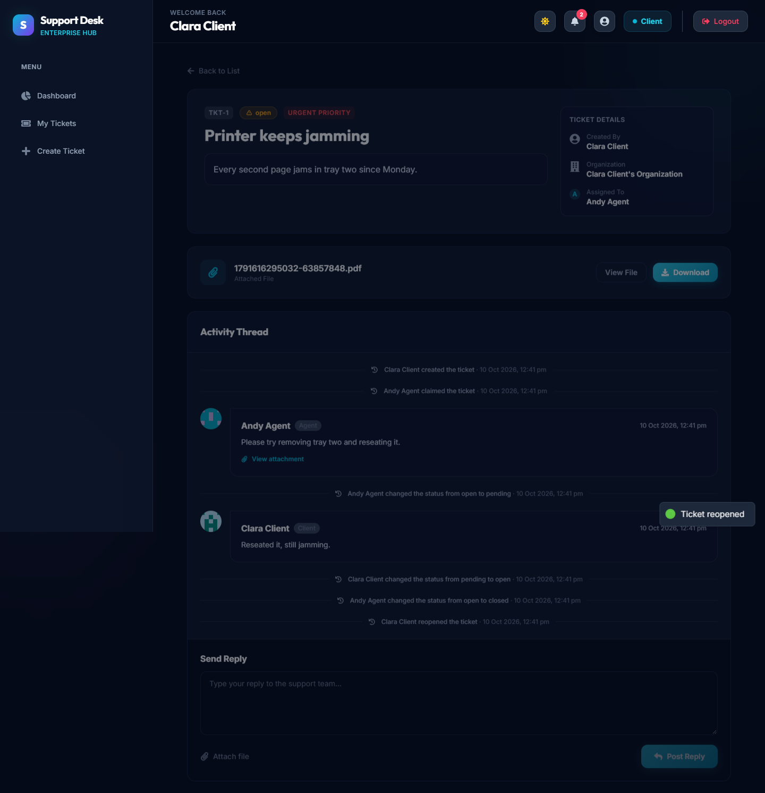
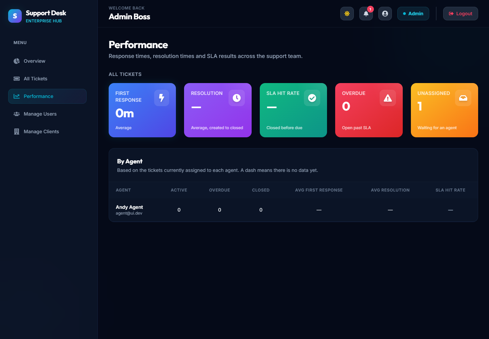
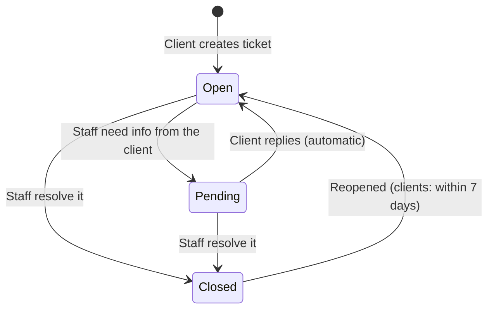
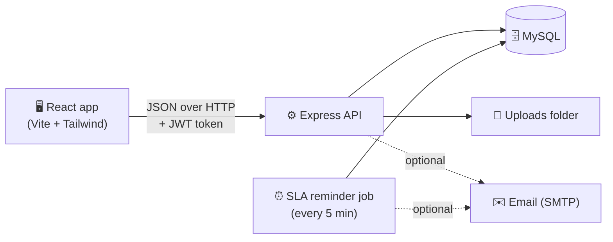

<div align="center">

# 🎫 Support Ticketing Tool

**A help desk where clients raise tickets, agents solve them, and admins see how it's all going.**


[Features](#-features) •
[Screenshots](#-screenshots) •
[Quick start](#-quick-start) •
[Who can do what](#-who-can-do-what) •
[How a ticket moves](#-how-a-ticket-moves) •
[Commands](#-commands) •
[API](#-api-reference) •
[Troubleshooting](#-troubleshooting)

</div>

---

## 📖 What is this?

A full-stack support desk with three kinds of users:

| | Role | What they do |
|---|---|---|
| 🙋 | **Client** | Raises tickets, replies, attaches files, reopens a ticket if the problem comes back |
| 🧑‍💻 | **Agent** | Claims tickets from a shared queue, replies, writes private notes, closes tickets |
| 🛡️ | **Admin** | Sees every ticket, assigns work, manages users, and tracks team performance |

Every ticket has a priority, a deadline (SLA) based on that priority, and a full history of who did what.

---

## ✨ Features

<details open>
<summary><b>🎟️ Tickets</b></summary>

- Create tickets with a title, description, priority, and an optional file
- Reply in a conversation thread; staff can add **internal notes** that clients never see
- **Filter** any list by status, priority, or overdue, and **sort** by newest, oldest, due soonest, or highest priority
- **Audit timeline**: every claim, assignment, status change, and reopen is recorded and shown in the thread

</details>

<details>
<summary><b>👥 Teamwork</b></summary>

- Agents **claim** tickets from the unassigned queue; if two click at once, only one wins
- Admins can **assign, reassign, or unassign** any ticket
- **In-app notifications** (the bell in the header) for new tickets, replies, assignments, status changes, reopens, and SLA warnings
- Optional **email notifications** for the same events

</details>

<details>
<summary><b>⏱️ Deadlines (SLA)</b></summary>

Each ticket gets a due date from its priority:

| Priority | Due within |
|---|---|
| 🔴 Urgent | 4 hours |
| 🟠 High | 24 hours |
| 🔵 Medium | 3 days |
| 🟢 Low | 7 days |

Lists show whether each ticket is **On Track** or **Overdue**, and the assigned agent is reminded one hour before the deadline.

</details>

<details>
<summary><b>📊 Dashboards</b></summary>

- A dashboard for each role with ticket counts and charts
- **Performance page** for admins: average first-response time, average resolution time, and SLA hit rate, overall and per agent

</details>

<details>
<summary><b>🔒 Security</b></summary>

- Passwords hashed with bcrypt; sessions use JWT tokens that expire after 8 hours
- Every request is checked against the user's role **and** their right to that specific ticket
- Public signup can only create client accounts; agents and admins must be created by an admin
- Uploaded files are checked by extension, type, **and actual contents**, and can only be downloaded by someone allowed to see the ticket
- Rate limits on login, signup, and the API as a whole
- All input is validated; all database queries are parameterised

</details>

---

## 📸 Screenshots

| Client dashboard with notifications | Ticket list with filters |
|---|---|
|  |  |

| Ticket conversation and audit timeline | Admin performance page |
|---|---|
|  |  |

---

## 🚀 Quick start

### What you need

- [Node.js](https://nodejs.org/) 20 or newer
- [MySQL](https://dev.mysql.com/downloads/) 8, running

### Step 1 — Get the code

```bash
git clone https://github.com/shivampatil4972/support-ticketing-tool.git
cd support-ticketing-tool
```

### Step 2 — Set up the backend

```bash
cd backend
npm install
```

Copy `.env.example` to `.env`, then open `.env` and set at least these two values:

```env
DB_PASSWORD=your_mysql_password
JWT_SECRET=any_long_random_text
```

### Step 3 — Create the database

```bash
mysql -u root -p < schema.sql
npm run migrate
```

> 💡 `schema.sql` creates the starting tables. `npm run migrate` applies every change made since. Run `npm run migrate` again whenever you pull new code.

### Step 4 — Create your admin account

```bash
npm run create-admin -- "Your Name" you@example.com "YourPassword"
```

### Step 5 — Set up the frontend

```bash
cd ../frontend
npm install
```

### Step 6 — Run it

<details open>
<summary><b>🪟 Windows: one click</b></summary>

Double-click **`run.bat`** in the project folder. It starts both servers in their own windows.

</details>

<details>
<summary><b>💻 Any system: two terminals</b></summary>

```bash
# Terminal 1
cd backend
npm run dev

# Terminal 2
cd frontend
npm run dev
```

</details>

Then open **http://localhost:5173** and log in with the admin account from step 4. 🎉

### Step 7 — Try the full flow

1. As **admin**, go to **Manage Users → Add User** and create an **agent**.
2. Open a private browser window, **sign up** as a client, and create a ticket.
3. Log in as the **agent**, open **Unassigned Queue**, and **claim** the ticket.
4. Reply, set the status to **Pending**, and watch the client's notification bell light up.

---

## 🧭 Who can do what

| Action | 🙋 Client | 🧑‍💻 Agent | 🛡️ Admin |
|---|:-:|:-:|:-:|
| Create a ticket | ✅ | — | — |
| See tickets | Own organisation's | Own + unassigned | All |
| Reply to a ticket | ✅ | ✅ | ✅ |
| Add an internal note | — | ✅ | ✅ |
| Claim an unassigned ticket | — | ✅ | — |
| Assign, reassign, unassign | — | — | ✅ |
| Change status | — | Own tickets | ✅ |
| Reopen a closed ticket | Within 7 days | ✅ | ✅ |
| Delete a ticket | — | — | ✅ |
| Manage users and organisations | — | — | ✅ |
| View the performance page | — | — | ✅ |

---

## 🔄 How a ticket moves



| Status | Meaning |
|---|---|
| **Open** | Waiting on the support team |
| **Pending** | Waiting on the client; their next reply moves it back to Open |
| **Closed** | Resolved. Clients must reopen it before replying again |

---

## 🏗️ How it's built



<details>
<summary><b>📁 Folder structure</b></summary>

```
support-ticketing-tool/
├── run.bat                 Start both servers on Windows
├── backend/
│   ├── server.js           Entry point
│   ├── app.js              Express setup, rate limits, routes
│   ├── schema.sql          Starting database tables
│   ├── migrations/         Database changes, applied in order
│   ├── routes/             URL → controller mapping and permissions
│   ├── controllers/        Read the request, send the response
│   ├── services/           Business rules and database queries
│   ├── middlewares/        Login check, role check, uploads, validation
│   ├── validations/        Input rules
│   ├── jobs/               SLA reminder job
│   ├── utils/              Email, SLA maths, response helpers
│   ├── scripts/            create-admin, migrate, end-to-end test
│   └── tests/              Unit tests
└── frontend/
    └── src/
        ├── pages/          One file per screen
        ├── components/     Reusable pieces (tables, buttons, bell)
        ├── layouts/        Sidebar and header
        ├── routes/         Which role can open which page
        ├── context/        Login state and theme
        └── services/       API client and attachment downloads
```

</details>

---

## 🧰 Commands

Run these inside the `backend` folder:

| Command | What it does |
|---|---|
| `npm run dev` | Start the API with auto-reload |
| `npm start` | Start the API |
| `npm run migrate` | Apply new database changes |
| `npm run create-admin -- "Name" email "password"` | Create an admin account |
| `npm test` | Run the 59 unit tests (no database needed) |
| `npm run test:e2e` | Run the whole workflow against a temporary database |
| `npm run test:email` | Send a test email to check your SMTP settings |
| `npm run lint` | Check the code for problems |

And inside the `frontend` folder:

| Command | What it does |
|---|---|
| `npm run dev` | Start the app at http://localhost:5173 |
| `npm run build` | Build for production into `dist/` |
| `npm run lint` | Check the code for problems |

> 🧪 `npm run test:e2e` creates its own database called `support_ticketing_e2e_tmp` and deletes it when finished. Your real data is never touched.

---

## ⚙️ Configuration

All backend settings live in `backend/.env`.

<details>
<summary><b>Show all settings</b></summary>

| Setting | Default | Purpose |
|---|---|---|
| `PORT` | `5000` | Port the API listens on |
| `JWT_SECRET` | — | **Required.** Secret used to sign login tokens |
| `DB_HOST`, `DB_PORT`, `DB_USER`, `DB_PASSWORD`, `DB_NAME` | — | **Required.** MySQL connection |
| `CORS_ORIGIN` | `*` | Address of the frontend, e.g. `http://localhost:5173` |
| `REOPEN_WINDOW_DAYS` | `7` | Days a client has to reopen a closed ticket |
| `RATE_LIMIT_MAX` / `RATE_LIMIT_WINDOW_MS` | `100` / 15 min | Login attempts per IP |
| `SIGNUP_RATE_LIMIT_MAX` / `SIGNUP_RATE_LIMIT_WINDOW_MS` | `10` / 1 hour | Signups per IP |
| `API_RATE_LIMIT_MAX` / `API_RATE_LIMIT_WINDOW_MS` | `1000` / 15 min | All API requests per IP |
| `EMAIL_USER`, `EMAIL_PASS` | — | Gmail address and app password. Leave unset to skip emails |
| `UPLOAD_DIR` | `backend/uploads` | Where attachments are stored |

The frontend has one optional setting in `frontend/.env`:

| Setting | Default | Purpose |
|---|---|---|
| `VITE_API_URL` | `http://localhost:5000/api` | Address of the API |

</details>

---

## 🔌 API reference

Every route except signup and login needs the header `Authorization: Bearer <token>`.

<details>
<summary><b>🔑 Auth</b></summary>

| Method | Route | Purpose |
|---|---|---|
| POST | `/api/auth/signup` | Create a client account |
| POST | `/api/auth/login` | Log in and receive a token |

</details>

<details>
<summary><b>🎟️ Tickets</b></summary>

| Method | Route | Who | Purpose |
|---|---|---|---|
| GET | `/api/tickets` | All | List tickets you can see |
| GET | `/api/tickets/assigned` | Agent | Tickets assigned to you |
| GET | `/api/tickets/unassigned` | Agent | The unassigned queue |
| POST | `/api/tickets` | Client | Create a ticket (multipart, optional `attachment`) |
| GET | `/api/tickets/:id` | All | Ticket, replies, and timeline |
| POST | `/api/tickets/:id/reply` | All | Add a reply (optional `attachment`) |
| POST | `/api/tickets/:id/internal-note` | Staff | Add a private note |
| PATCH | `/api/tickets/:id/status` | Staff | Set `open`, `pending`, or `closed` |
| POST | `/api/tickets/:id/claim` | Agent | Take an unassigned ticket |
| PATCH | `/api/tickets/:id/assign` | Admin | Assign; send `assigned_agent_id: null` to unassign |
| POST | `/api/tickets/:id/reopen` | All | Reopen a closed ticket |
| DELETE | `/api/tickets/:id` | Admin | Delete a ticket |
| GET | `/api/tickets/:id/attachment` | All | Download the ticket's file |
| GET | `/api/tickets/:id/comments/:commentId/attachment` | All | Download a reply's file |
| GET | `/api/tickets/dashboard` | Agent | Agent dashboard counts |
| GET | `/api/tickets/client-dashboard` | Client | Client dashboard counts |

**List options** (query string): `page`, `limit` (max 100), `search`, `status`, `priority`, `sla=overdue`, and `sort` (`newest`, `oldest`, `due`, `priority`).

</details>

<details>
<summary><b>🔔 Notifications</b></summary>

| Method | Route | Purpose |
|---|---|---|
| GET | `/api/notifications` | Your latest 20 notifications and unread count |
| PATCH | `/api/notifications/:id/read` | Mark one as read |
| PATCH | `/api/notifications/read-all` | Mark all as read |

</details>

<details>
<summary><b>🛡️ Admin</b></summary>

| Method | Route | Purpose |
|---|---|---|
| GET | `/api/admin/dashboard` | System-wide counts |
| GET | `/api/admin/performance` | Response time, resolution time, SLA hit rate |
| GET | `/api/admin/users` | List active users |
| POST | `/api/admin/users` | Create a user of any role |
| PUT | `/api/admin/users/:id` | Update a user |
| DELETE | `/api/admin/users/:id` | Deactivate a user |
| GET | `/api/admin/clients` | List organisations |
| POST | `/api/admin/clients` | Create an organisation |
| PUT | `/api/admin/clients/:id` | Rename an organisation |
| DELETE | `/api/admin/clients/:id` | Delete an organisation with no active tickets |

</details>

<details>
<summary><b>📦 Response format</b></summary>

Every response has the same shape:

```json
{
  "success": true,
  "data": { },
  "message": "Ticket created successfully",
  "error": null
}
```

</details>

---

## 🩺 Troubleshooting

<details>
<summary><b>The login page says "Invalid credentials"</b></summary>

Check the email and password. Passwords can't be recovered and there is no reset screen yet, so if you've forgotten an admin password, create a new admin with `npm run create-admin`. A deactivated account also shows this message.

</details>

<details>
<summary><b>The page loads but nothing appears, or every request fails</b></summary>

The backend probably isn't running. Open http://localhost:5000/health; you should see `"status":"ok"`. If not, start it with `npm run dev` in `backend` and read the error it prints.

</details>

<details>
<summary><b>"Unknown column" or "Table doesn't exist" errors</b></summary>

Your database is behind the code. Run `npm run migrate` in `backend`.

</details>

<details>
<summary><b>"Access denied for user" when the backend starts</b></summary>

The MySQL username or password in `backend/.env` is wrong.

</details>

<details>
<summary><b>"Port 5000 (or 5173) is already in use"</b></summary>

An old copy is still running. On Windows, `run.bat` closes it for you. Otherwise close the old terminal, or change `PORT` in `backend/.env`.

</details>

<details>
<summary><b>I can't create an agent or admin from the signup page</b></summary>

That's deliberate. Signup only creates clients. Log in as an admin and use **Manage Users → Add User**.

</details>

<details>
<summary><b>My file won't upload</b></summary>

Only JPG, PNG, PDF, DOC, and DOCX files up to 5 MB are accepted, and the file's contents must match its extension. A renamed file is rejected.

</details>

<details>
<summary><b>No emails are being sent</b></summary>

Emails are skipped until `EMAIL_USER` and `EMAIL_PASS` are set in `backend/.env`. For Gmail, use an [app password](https://support.google.com/accounts/answer/185833), then run `npm run test:email`. The app works fully without email; the notification bell covers the same events.

</details>

---

## 🗺️ Roadmap

- [ ] Live updates over WebSockets (notifications currently refresh every 30 seconds)
- [ ] Password reset by email
- [ ] Saved SLA reminder state, so a restart never repeats a reminder
- [ ] Frontend automated tests
- [ ] Docker setup for one-command install

---

<div align="center">

Built by [Shivam Patil](https://github.com/shivampatil4972)

</div>
